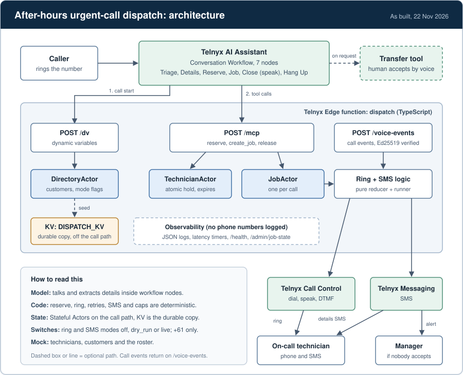

# dispatch: after-hours urgent-call assistant

A voice assistant for a trade business (plumbing, electrical, gas). After hours it answers the phone, decides whether the call is an emergency, collects the details, reserves an on-call technician, rings them, and texts the details. If nobody accepts, the manager gets a text. Built on Telnyx for the Forward Deployed Engineer (ANZ) take-home.

## Try it

- Phone number: in the submission email.
- Health check: `https://dispatch-b823b5bf-9.telnyxcompute.com/health` (booleans only, no secrets).
- Say "my kitchen tap burst" for the urgent path. Ask for "a person" for the human transfer. Say "there is a gas smell" to hear the safety line.

## How it works



- **Workflow first.** The call path is fixed: Triage, Details, Reserve, Job, Close, Hang Up, with a Fallback. The model only talks and extracts details inside a node.
- **Code decides.** Reserving a technician, the ring, retries (2 attempts), the manager alert and the safety caps are deterministic code behind MCP tools, so a model mistake cannot double-book or skip escalation.
- **Safety switches.** Ring and SMS each have a mode (`off`, `dry_run`, `live`) held in DirectoryActor. Only `+61` numbers can be dialled, with per-technician cooldown and daily caps.
- **Human escalation.** Emergencies are told to call triple zero. If the caller asks for a person, the assistant uses Telnyx's transfer tool and the human accepts by voice; if nobody does, the assistant carries on logging the job.
- **State.** Stateful Actors for hot state (TechnicianActor, JobActor, DirectoryActor). KV holds the seeded durable copy only.

MCP tools used by the workflow: `reserve_technician`, `create_job`, `release_technician`. `lookup_customer` is registered but not used by the workflow.

More: `docs/architecture.md`, `docs/decisions.md`, `docs/use-case.md`, `docs/portal/` (the exact Portal configuration).

## Run and test

```
npm ci
npm run typecheck
env -u MCP_TOKEN -u TELNYX_API_KEY -u ADMIN_TOKEN npm test
telnyx-edge secrets add <NAME>      # names are in .env.example; never commit values
telnyx-edge ship
```

The `env -u` prefix stops real tokens in your shell from changing the auth tests.

## Observability

Logs are one JSON object per line on stdout, written only by `src/lib/log.ts`. Fields include `component`, `event`, `level`, `request_id` and `call_ref`. Phone numbers are never logged, only a salted hash.

```
telnyx-edge logs dispatch --since 30m --last 250
telnyx-edge logs dispatch --type invocations --since 30m
telnyx-edge actors logs TechnicianActor --since 60m
telnyx-edge metrics dispatch
```

Beyond logs: per-hop latency timers on each tool call, and `GET /admin/job-state` (admin token) shows a call's ring and SMS status. The transfer outcome is visible in Portal conversation history, not in function logs.

## How this was built

All repo code was written with Telnyx Inference (Kimi-K3) through OpenCode (`@telnyx/opencode`), one task file per slice in `docs/tasks/`, with `AGENTS.md` as the standing rules. Planning, specs and review notes were drafted with Claude and owned by the author. Findings about the platform and tools: `docs/dogfooding.md`, `docs/bug-journal.md`, `docs/verify-log.md`.

## Limits

- Technicians, customers and the roster are mock data.
- Safety wording (gas, water near electrics) is scripted and needs review by a licensed tradesperson before any real use.
- Only the Australian `+61` prefix is allowed for outbound rings and texts.
- No published inbound concurrency limit was found for assistants; outbound calls default to a low concurrent limit on a new account.
- The ring voice is a different TTS voice from the assistant's.
