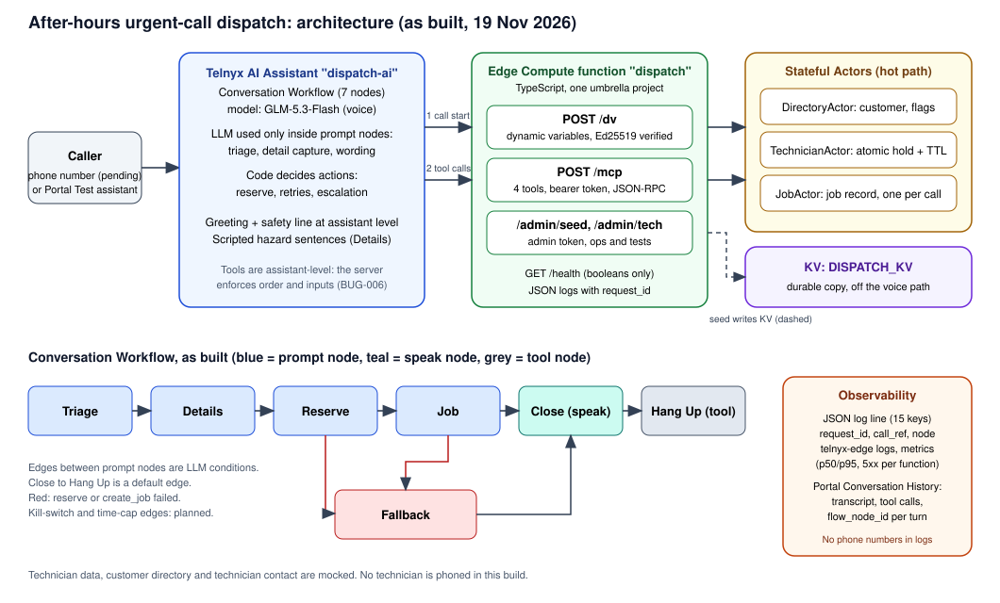
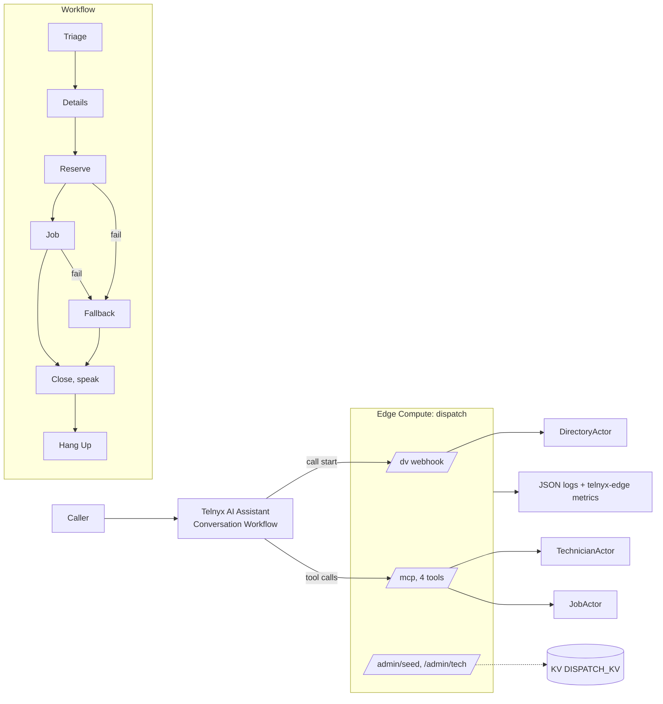

# Architecture

## Call flow

1. Caller reaches the assistant (Portal Test assistant today; phone number pending).
2. Telnyx calls `POST /dv` once at call start. The function verifies the Ed25519 signature, looks up the caller in DirectoryActor and returns dynamic variables (for example the caller's name). Hot state is in actor storage, not KV (D13).
3. The Conversation Workflow runs: Triage, Details, Reserve, Job, Close (speak), Hang Up. A failure in Reserve or Job goes to Fallback, then Close.
4. Reserve and Job call MCP tools on `POST /mcp`. TechnicianActor holds a technician atomically with a time limit; JobActor stores the job record.
5. Logs: one JSON line per request with `request_id`, `call_ref` and the node. No phone numbers.

## Design rules

- The model talks and extracts; code decides. Reservation, retry and escalation are deterministic (D12).
- Tools are assistant-level in Telnyx, so prompts cannot scope them. The server enforces order and required inputs and returns `next: "fallback"` on failure (BUG-006, D17).
- Hot path avoids KV (BUG-003, D13).

## Mermaid version

