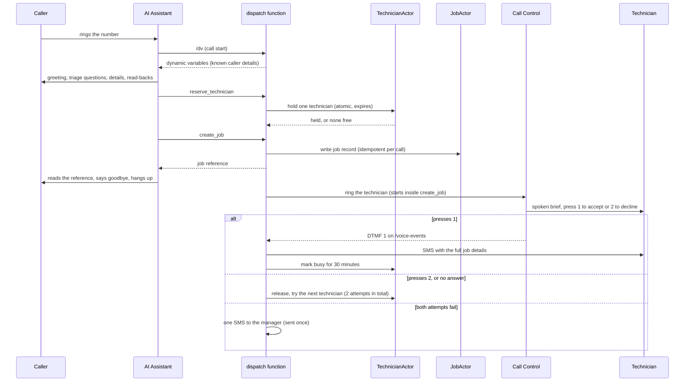
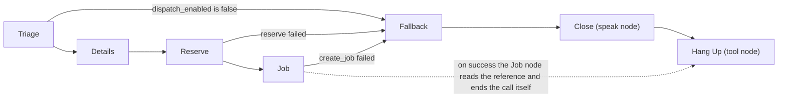

# Architecture

This is the as-built system (22 Nov 2026). It answers three questions: what happens on a call, where each piece runs, and what happens when something fails. Decisions and their reasons are in `decisions.md` (numbered D1 onwards), and the exact Portal configuration is in `portal/`.

## In one paragraph

A caller rings the number. A Telnyx AI Assistant runs a Conversation Workflow that works out urgency and trade, collects and confirms the details, then calls our MCP server. The server reserves an on-call technician, records a job and rings the technician. The technician presses 1 to accept or 2 to decline. On accept they get the details by SMS. If nobody accepts after two attempts, the manager gets one SMS. The model only talks and extracts details inside a node. Everything that has a consequence (the hold, the ring, retries, the SMS, the caps) is deterministic code in one Telnyx Edge function.

## System view

## One call, step by step

The caller has already hung up before the technician is rung. The assistant never promises that a technician will call back, because that is not known at that point.

## The conversation workflow

- 7 nodes, no edge points backwards, so a call cannot loop. Every path ends at Hang Up.
- Triage, Details, Reserve, Job and Fallback are prompt nodes. Close is the speak node. Hang Up is a tool node.
- The edges between prompt nodes are LLM conditions and are only advisory. The model often does the whole call from one node, so the assistant-level instructions carry the full sequence and the server enforces order and required inputs (BUG-006, D17).
- Two paths sit outside the node graph, handled in the assistant instructions: emergencies are told to hang up and call triple zero, and a caller who asks for a person is connected with the transfer tool.

## What runs where

| Piece | Where | Code |
|---|---|---|
| Greeting, triage, details, read-backs, hazard lines | Telnyx AI Assistant (Portal) | `docs/portal/` is the source of truth |
| Dynamic variables at call start | `POST /dv`, Ed25519 verified | `src/routes/dv.ts` |
| MCP server, bearer auth | `POST /mcp` | `src/routes/mcp.ts`, `src/tools/` |
| Tools in use | `reserve_technician`, `create_job`, `release_technician` | `src/tools/` |
| Ring (2 attempts, DTMF 1 or 2) | pure reducer plus runner | `src/lib/ring.ts`, `src/lib/ringrun.ts` |
| Call events from Telnyx | `POST /voice-events`, Ed25519 verified | `src/routes/voice.ts` |
| Accept SMS, manager SMS | Telnyx Messaging | `src/lib/sms.ts` |
| Technician hold, job record, flags | Stateful Actors | `src/actors/` |
| Durable seeded copy | KV `DISPATCH_KV` | `src/lib/kv-keys.ts` |
| Ops and tests | `/admin/seed`, `/admin/tech`, `/admin/job-state`, `/admin/ring-test` (admin token) | `src/routes/` |
| Fallback timer | `POST /ring-start` (only if the inline start fails) | `src/routes/ringstart.ts` |

`lookup_customer` is also registered but the workflow does not use it, because the caller is identified in `/dv` before the model speaks.

## State: why actors and KV

- **TechnicianActor** holds the truth about who is free. A hold is atomic and expires, so two calls cannot take the same technician (6 parallel reserves gave one winner, V-014). Busy time after an accepted job is 1800 s.
- **JobActor** (one per call) holds the job record and the ring and SMS status. Writes are keyed on the call, so a repeated tool call is idempotent (D5).
- **DirectoryActor** holds known customers and the mode flags.
- **KV** is the durable copy and is slow (about 1.5 to 1.9 s per operation), so it is kept off the voice path (D13, BUG-003).

## When something goes wrong

| What fails | What happens |
|---|---|
| No technician free, or reserve fails | Tool returns `next: "fallback"`. The assistant apologises, gives the office number, says triple zero if it is an emergency, and does not claim anything was logged. |
| Callback number invalid | One bounded retry with a spoken read-back, then Fallback. |
| `create_job` fails | Fallback, and the technician hold is released. |
| Technician declines or does not answer | Release, try the next technician. Two attempts in total. |
| Nobody accepts | One SMS to the manager, sent once even if events repeat. |
| Caller asks for a person | Transfer tool, human accepts by voice. If nobody does, the assistant says so and carries on logging the job. |
| Dispatch switched off (`dispatch_enabled` false) | A variable-comparison edge sends the call from Triage to Fallback, and `reserve_technician` also refuses, so nobody is reserved or rung. |
| Ring or SMS flag is `off`, `dry_run` or missing (missing counts as `dry_run`) | Nothing is dialled or sent. `dry_run` logs what would have happened. Only `live` acts. |
| Number not `+61`, over the daily cap, or inside the cooldown | The ring or SMS is skipped and a log line says why. |
| Telnyx webhook has a bad signature | Rejected before any logic runs. |

## Observability

- One JSON log line per event on stdout, only through `src/lib/log.ts`. Fields include `component`, `event`, `request_id` and `call_ref`. No phone number is ever logged, only a salted hash.
- Read them with `telnyx-edge logs dispatch` and `telnyx-edge actors logs TechnicianActor`. Request counts and latency percentiles: `telnyx-edge metrics dispatch`.
- A second signal besides logs: per-hop latency timers on each tool call, and `GET /admin/job-state` (admin token), which shows one call's ring and SMS status.
- The transfer outcome shows in Portal conversation history, not in function logs.

Measured on 20 to 21 Nov: `reserve_technician` about 1.3 s, `create_job` about 2.9 s including the inline ring start. The assistant speaks a filler line while a tool runs (D15).

## How this maps to the brief

| Brief asks for | Where it is |
|---|---|
| Multi-node workflow with a speak node | 7-node Conversation Workflow, Close is the speak node |
| Custom MCP server with 3 or more tools | `/mcp`, three tools in use |
| Dynamic-variables webhook on Edge Compute | `/dv` |
| KV | `DISPATCH_KV` |
| Stateful Actor | TechnicianActor, JobActor, DirectoryActor |
| Structured logs plus another signal | JSON logs, latency timers, `/admin/job-state`, metrics |
| Public URLs and a dialable number | The function URL in the README, number in the submission email |

## Mocked or not built

- Technicians, customers and the roster are mock data.
- Safety wording is scripted and needs review by a licensed tradesperson before real use.
- Not built: a time-cap edge, the golden set in CI, and a separate Escalate node (a caller who asks for a person is handled by the transfer tool). The kill-switch edge is built and was drilled live on 23 Nov.
- No published inbound concurrency limit was found for assistants.
